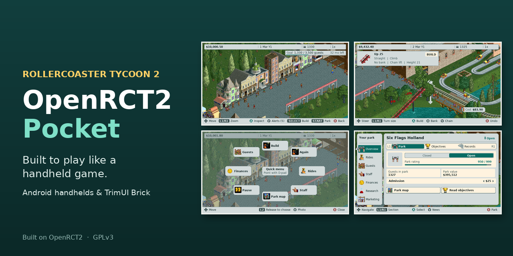
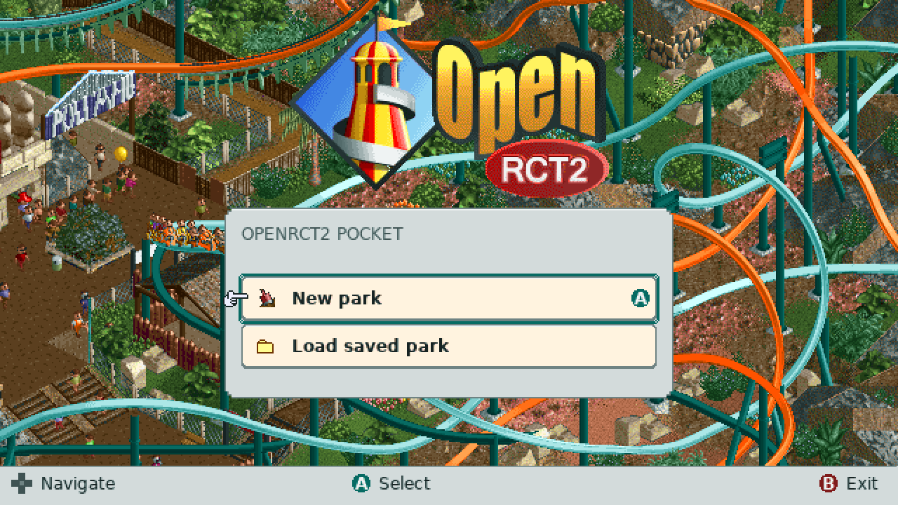
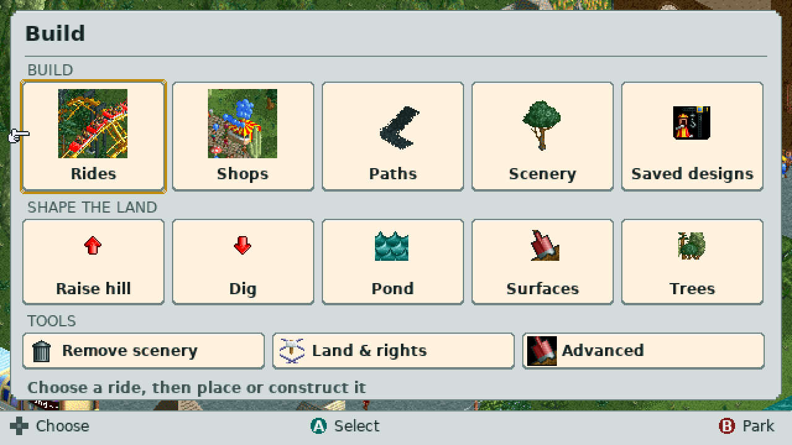
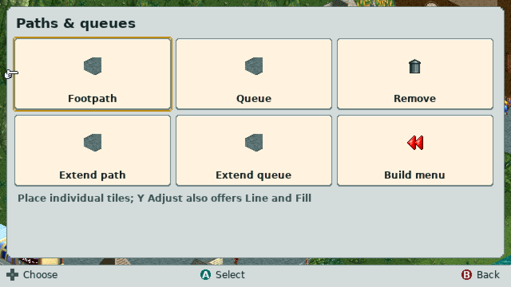
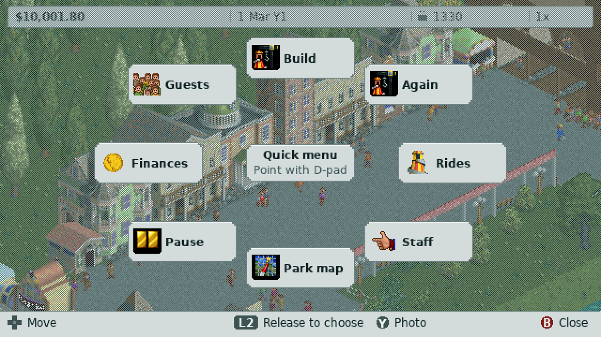
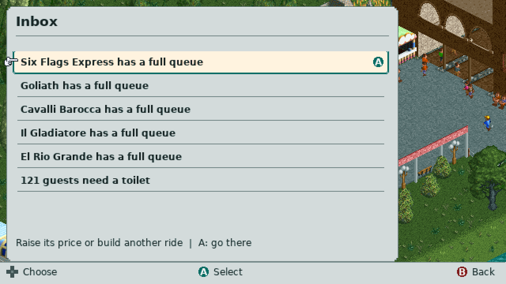
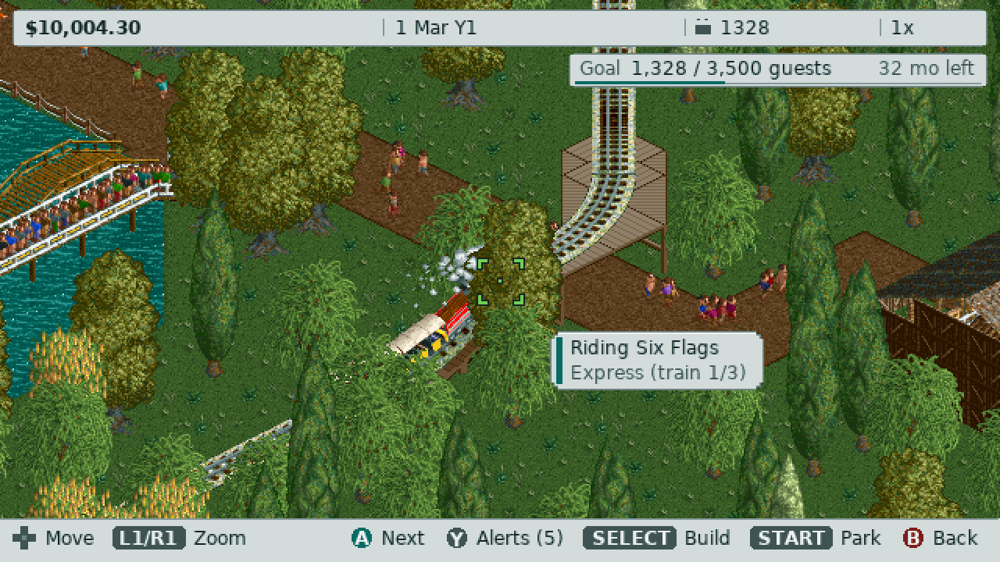
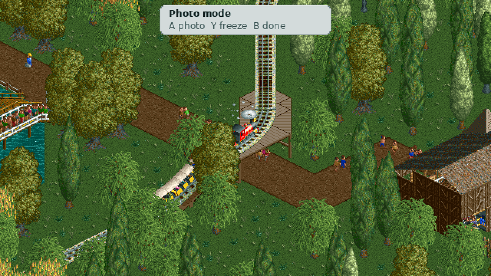

  

<b>RollerCoaster Tycoon 2, rebuilt to play like a handheld game.</b> 
A controller-first build of <a href="https://github.com/OpenRCT2/OpenRCT2">OpenRCT2</a> for Linux and Android.

  

  
  
  

Most ways of playing RCT2 on a handheld map the stick to a mouse and leave you squinting at desktop windows. Pocket takes a different approach: the camera moves and the cursor stays in the middle of the screen, every screen has a button footer, and management happens in sheets you page through with the shoulder buttons. It's meant to feel like a GBA-era sim that happens to run RCT2's simulation underneath.

The park renderer, simulation, game actions and save format are OpenRCT2's own, so parks behave exactly as they do on PC. Pocket changes only presentation and input, and only when `OPENRCT2_HANDHELD=1` is set; without it this is ordinary desktop OpenRCT2.

## Play on your device

You need the `Data`, `ObjData`, and `Scenarios` folders from your own copy of RollerCoaster Tycoon 2, available on Steam and GOG. Pocket builds do not include those files.

| Platform | Where to start | Status |
|---|---|---|
| TrimUI Brick | [Brick Pak](../../releases) · [Install guide](#install-on-a-trimui-brick) | Beta on NextUI and NX Redux |
| Android 7.0+ (ARM) | [APK install guide](#install-on-android) | Tested on Retroid Pocket Flip 2. A controller is required for gameplay. |
| Other Linux devices | [Build and run Pocket mode](#run-on-other-linux-devices) | Build from source. Firmware and controller compatibility vary. |

## What's different

- **Fixed centre cursor.** The D-pad or left stick moves the park under the cursor. The footer tells you what A will do (*Inspect ride*, *Inspect guest*...) and a chip names what's under the cursor.
- **Pocket screens instead of desktop windows.** Guests, rides, staff, finances, research and marketing open as full-screen sheets with L1/R1 tabs and remembered focus.
- **Building made for a D-pad.** Paths with Single, Line and Fill modes and live cost, plus terrain, water, scenery, trees, shops, flat rides, mazes and custom coasters.
- **Handheld session basics.** Save slots, Save and quit, direct speed choices (Paused, 1x, 2x, 4x), and a quit shortcut that always offers to save.
- **Built for the screen.** A 512×384 logical canvas at 2× on the Brick's 1024×768 display, with its own Pocket Sans type.

  
  
  

## Made for a handheld

Shortcuts and habits that only make sense with a controller in your hands.

  
  

- **Quick menu (hold L2).** Build, Rides, Staff, Guests, Finances, the park map, pause, and "Again" (the last Build card) around the cursor. Point and release.
- **Undo (hold B in a tool).** Takes back your last land, scenery, tree or shop change and refunds what it cost.
- **Entrance, exit and paths in one press.** While placing a ride's entrance, Y picks the best sides of the station and lays a queue and exit path to the nearest footpath.
- **Context A.** On the end of a path, A carries on building it; on a sign, A edits it.
- **Your goal at a glance.** The scenario objective sits under the HUD as a progress bar, with the months left (or the park rating, if that's what's holding you back). The clock and battery level can go in the top bar too.
- **Inbox (hold Y).** Everything that needs you right now (breakdowns, full queues, hungry guests), above the park news. A tap on Y glides to each problem in turn.

  
  

- **Ride along.** From a ride's page, the camera follows a train, zoomed in. A switches trains.
- **Photo mode (L2, then Y).** All UI hidden; A saves a clean screenshot, Y freezes time.
- **Resume your park.** Pocket saves on a normal system exit. You can also have the game skip the title and continue your last park.
- **A controls guide and a first-run intro** that draw the device and ring the buttons each page is talking about.
- **Settings:** theme (Daylight, Slate, Pixel), reduced motion, an optional smart cursor that settles onto rides and guests, and the HUD and device options above.

  
  
  

## Controls

| Button | In the park |
|---|---|
| D-pad / left stick | Move the camera (the cursor stays centred) |
| A | Inspect what's under the cursor |
| B | Back / close |
| X | Rotate the view |
| Y | Next alert (hold: inbox; news when all is well) |
| L1 / R1 | Zoom out / in |
| L2 (hold) | Quick menu (then Y: photo mode) |
| Select | Build menu |
| Start | Park dashboard (press again for the pause menu) |
| Start + Select | Quit, with a Save and quit prompt |

| Button | In build tools |
|---|---|
| A | Place |
| X | Remove |
| Y | Adjust (turn, height, mode) |
| L2 / R2 | Height |
| B | Back (hold: undo) |

| Button | In sheets and menus |
|---|---|
| D-pad / left stick | Choose |
| A | Select |
| L1 / R1 | Change tab |
| X | Contextual action, when shown |
| B | Back |

The pause menu's **Controls...** page shows all of this in-game, including the hold gestures, and can replay the intro.

## Install on a TrimUI Brick

You need your own copy of RollerCoaster Tycoon 2 (it's sold on Steam and GOG). **No game data is included here, and none should ever be added to this repository.**

1. Get the Pak from [Releases](../../releases). Testing builds of every commit are attached to the [Testing workflow runs](../../actions/workflows/testing.yml) as artifacts. To build it yourself, run `packaging/handheld/nextui/ci-build.sh` (see [the NextUI packaging guide](packaging/handheld/nextui/BUILD.md)).
2. Extract it to the SD card root so that `Tools/tg5040/OpenRCT2 Pocket.pak/launch.sh` exists. On frontends without platform folders (such as NX Redux), move the Pak to `Tools/OpenRCT2 Pocket.pak` instead; either layout works.
3. Copy the `Data`, `ObjData` and `Scenarios` folders from your RCT2 install into the `RCT2/` folder inside the Pak you just installed. Check that `RCT2/Data/g1.dat` exists.
4. Eject the card and launch **OpenRCT2 Pocket** from your firmware's **Tools** menu.

Saves and settings live in `.userdata/tg5040/openrct2-pocket/` and survive updates. See [INSTALL.md](packaging/handheld/nextui/INSTALL.md) for updating, logs and troubleshooting.

## Install on Android

Pocket requires Android 7.0 or newer on a 32-bit or 64-bit ARM device. Use the built-in controls on a handheld or connect a controller. The setup dialog supports touch and the D-pad.

1. Install an `-android.apk` from [Releases](../../releases) when available, or download a test APK from the **Artifacts** section of a successful [Testing run](../../actions/workflows/testing.yml?query=branch%3Amain). Sign in to GitHub to download the artifact and unzip it to get the APK.
2. Launch **OpenRCT2 Pocket** and allow file access when prompted. Pocket checks for existing game data in `openrct2-pocket/RCT2`, `rct2`, and `RCT2` on internal storage and mounted SD cards.
3. If it cannot find your data, choose **Choose folder** and select the parent folder containing `Data`, `ObjData`, and `Scenarios`. Pocket remembers your choice. You can also put the files in `openrct2-pocket/RCT2/` and choose **Check again**.

Saves and settings live in `openrct2-pocket/` on internal storage. Back them up before switching from a test APK to a signed release. Android requires reinstalling when the APK signing key changes.

## Run on other Linux devices

[Build OpenRCT2 Pocket for your device](docs/handheld/BUILDING.md), connect an SDL-mapped controller, and launch with `OPENRCT2_HANDHELD=1`. You can set `OPENRCT2_HANDHELD_LEFT_STICK=0` to use the D-pad alone. The repository includes an experimental [PortMaster launcher](packaging/handheld/OpenRCT2-Handheld.sh) that needs a build compatible with the target firmware.

## Building and testing

- **Brick (AArch64) Pak:** [packaging/handheld/nextui/BUILD.md](packaging/handheld/nextui/BUILD.md)
- **Android APK:** [src/openrct2-android/BUILDING-POCKET.md](src/openrct2-android/BUILDING-POCKET.md)
- **Native Linux build and tests:** [docs/handheld/BUILDING.md](docs/handheld/BUILDING.md). Run with `OPENRCT2_HANDHELD=1` to get the handheld UI on a desktop.
- **Standalone tests:** `cmake -S test/handheld -B build-input-tests -G Ninja && cmake --build build-input-tests && ctest --test-dir build-input-tests`
- **In-game test drivers** (need your RCT2 data): `scripts/handheld/verify-ui-redesign.py --driver <name> ...`

The handheld layer lives in [`src/openrct2-ui/handheld/`](src/openrct2-ui/handheld) with small hooks into upstream code, which keeps merging upstream releases manageable. Design notes and verification records are in [`docs/handheld/`](docs/handheld).

## Known issues

- Saving on sleep relies on the power button reaching the game as a key; if NextUI doesn't pass it through, the park is still saved whenever the system closes the game.
- Auto entrance/exit only finds level routes; on a raised station it places both and tells you the paths still need building.
- Large, late-game parks haven't been performance-tested on the Brick's CPU.
- Changes since the last device-tested release are verified with native builds and test drivers only until they're checked on hardware.

## Licence and credits

OpenRCT2 Pocket is a fork of [OpenRCT2](https://github.com/OpenRCT2/OpenRCT2) and, like it, is licensed under the GNU General Public License v3 or later; see [licence.txt](licence.txt).

**This project stands entirely on the work of the OpenRCT2 team and its many contributors** ([contributors.md](contributors.md)). Over more than a decade they reverse-engineered RollerCoaster Tycoon 2, rebuilt it as open source, and kept extending it. The simulation, renderer, game actions, save format and nearly everything that makes a park feel alive are theirs; Pocket only adds a handheld layer on top. If you enjoy this, please support and contribute to [upstream OpenRCT2](https://github.com/OpenRCT2/OpenRCT2).

Thanks also to Chris Sawyer, who created RollerCoaster Tycoon, and to the NextUI and TrimUI communities for the platform this runs on. The upstream README is kept at [docs/handheld/history/UPSTREAM-README.md](docs/handheld/history/UPSTREAM-README.md).

This is an unofficial fan project. It isn't affiliated with or endorsed by the OpenRCT2 team or Atari. RollerCoaster Tycoon is a trademark of its respective owner. Pocket Sans is a raster derivative of DejaVu Sans, distributed under the DejaVu font licence ([PocketSans.LICENSE](src/openrct2-ui/handheld/PocketSans.LICENSE)).
